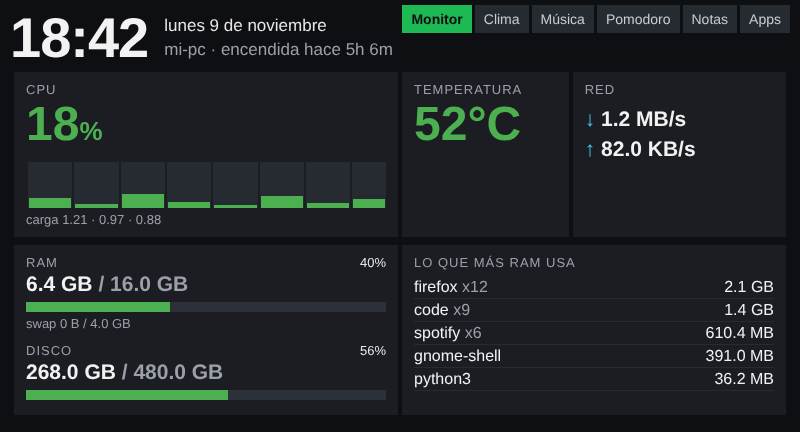
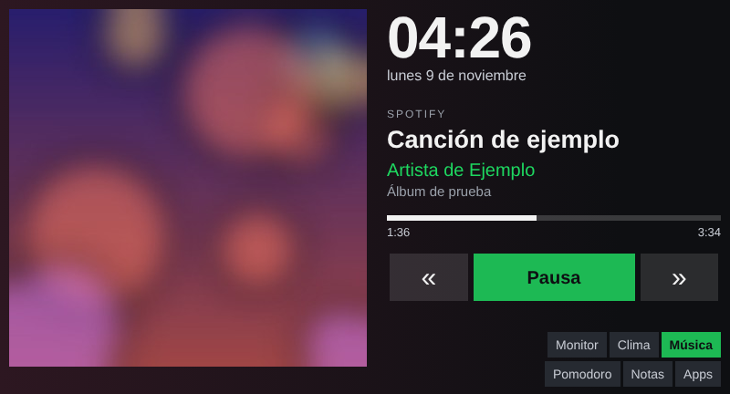
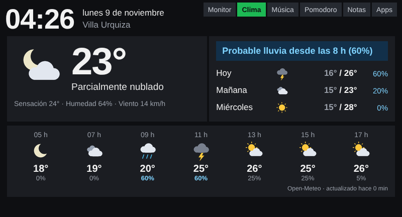
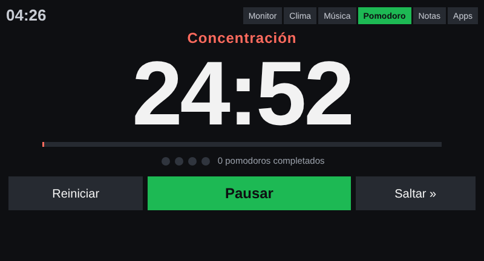
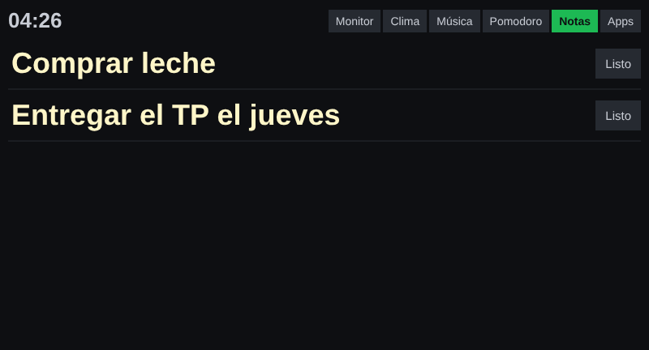
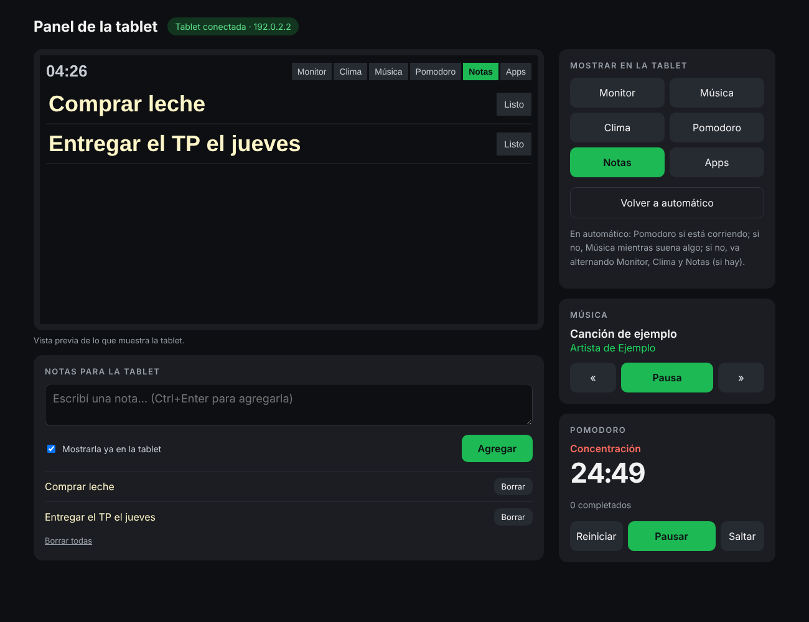

# old-tablet-dashboard · una segunda vida para una tablet de 2012


*[Read in English](README.md)*

Un dashboard de escritorio para una **Coby Kyros MID7033** vieja (Android 4.0, 512 MB de RAM, pantalla resistiva de 800×480 con el touch roto). Un solo archivo de Python que corre en mi PC con Ubuntu sirve las páginas que la tablet muestra a pantalla completa: estado de la PC, lo que suena en Spotify, el clima de mi barrio, un pomodoro y notas que escribo desde la PC.

En la tablet no hay nada instalado y no hace falta root: es el navegador de fábrica de 2012 apuntando a mi PC.

| Monitor | Música | Clima |
|---|---|---|
|  |  |  |
| **Pomodoro** | **Notas** | **Panel de control (en la PC)** |
|  |  |  |

<sub>Las capturas usan datos de ejemplo.</sub>

## Qué hace

- **Monitor de la PC**: CPU (total y por núcleo), RAM, disco, temperatura, red y los programas que más memoria usan, leídos directo de `/proc` y `/sys`.
- **Música**: Spotify (o cualquier reproductor MPRIS) con portada, progreso y botones de anterior, pausa y siguiente que controlan la PC. El fondo toma el color de la portada.
- **Clima**: condiciones actuales, aviso de "¿llueve en las próximas 12 h?", pronóstico de 3 días y de las próximas horas ([Open-Meteo](https://open-meteo.com/), gratis y sin clave).
- **Pomodoro**: 25/5 con descanso largo cada 4 y notificación en el escritorio al cambiar de fase.
- **Notas**: se escriben en la PC y se ven enormes en la tablet; se marcan como listas con un clic. Se guardan en disco.
- **Uso de Claude**: los mismos porcentajes de la sesión de 5 horas y de la semana que muestra claude.ai, con la hora de reinicio, una cuenta regresiva y un aviso si a este ritmo vas a llegar al límite antes de que se restablezca. Se consulta cada 5 minutos con la sesión de Claude Code que ya está en la PC (no es una API oficial, ver abajo).
- **Rotación inteligente**: el pomodoro mientras corre, la música mientras suena algo y, si no, va alternando monitor, clima y notas. Una página elegida a mano se respeta 5 minutos. Se puede apagar desde el panel (modo fijo), y así la tablet solo cambia de página cuando se lo pedís.
- **Panel de control** en `http://localhost:8080/control`: vista previa en vivo, cambiar la página de la tablet, controlar la música y el pomodoro, escribir notas. Solo se puede abrir desde la propia PC.
- **Instalar apps**: dejás un `.apk` en `apk/` y lo instalás desde la tablet con un clic.

## Cómo funciona

La tablet carga cada página una sola vez. Después, un script pide `?parcial=1` cada 3 segundos y recibe solo las secciones de la página, separadas por un carácter separador ASCII. Reemplaza únicamente las que cambiaron, así la pantalla no parpadea y la portada no se redibuja si la canción es la misma. El último campo de cada respuesta es la página que debería mostrar la tablet: la sugerencia de la rotación o una orden del panel, que se usa una sola vez.

## Trabajar con un navegador de 2012

Los problemas más interesantes vinieron del hardware, no de las funciones:

| Restricción | Qué hice |
|---|---|
| El navegador no soporta TLS moderno: casi todos los sitios HTTPS fallan | Todo se sirve por HTTP simple en la red local. La PC baja lo que está en HTTPS (portadas, pronóstico) y se lo pasa a la tablet. |
| JavaScript ES5: sin `fetch`, `let`, funciones flecha ni template literals | El script de la tablet está escrito en ES5 con `XMLHttpRequest`. El diseño usa tablas en lugar de flexbox o grid. |
| No hay fuentes con emojis | Los íconos del clima se dibujan en la PC con Pillow como PNG transparentes y se guardan en caché. |
| La tablet se reporta como de baja densidad y el navegador achicaba todo al 75 % | `target-densitydpi=device-dpi` en el viewport: 1 px de CSS = 1 píxel real. |
| Cada cambio en el código obligaba a recargar la tablet a mano | Cada página lleva una huella de `monitor.py`. Si una página vieja pide datos, el servidor le ordena recargarse. |
| El touch está roto: se maneja con un mouse USB por OTG y escribir es incómodo | Nada en la tablet requiere escribir. Las notas y el control remoto están en el panel de la PC. |
| CPU débil y 512 MB de RAM | La portada se achica en la PC al tamaño exacto en píxeles. El color de fondo se calcula una vez por canción. |

Otros detalles:

- **Panel solo local.** Cualquier pedido que no venga de la propia PC recibe `403`, así que nadie más en el WiFi puede manejar la tablet ni editar notas.
- **Órdenes de un solo uso.** Una orden del panel la toma la primera consulta de la tablet y vence a los 60 s, así una orden vieja no cambia la pantalla más tarde.
- **Sin path traversal.** Las descargas de `apk/` pasan por `basename()` y el endpoint de íconos solo acepta una lista fija de nombres.
- **Escrituras atómicas.** Las notas se escriben en un archivo temporal y se mueven con `os.replace`, así un corte no deja el archivo a medias.
- **El uso de Claude es de solo lectura y queda en la PC.** La página usa el token que Claude Code guarda en `~/.claude/.credentials.json` para consultar el mismo endpoint de uso que consulta Claude Code. El token solo se manda a Anthropic: no se registra, no se guarda en otro lado y no llega ni a la tablet ni al panel. El servidor no lo renueva (así no interfiere con Claude Code): si vence, la página te pide abrir `claude`. No es una API pública documentada y puede cambiar; si pasa, solo esta página muestra un error.
- **Sin dependencias obligatorias.** Solo la biblioteca estándar. Pillow es opcional (íconos, portadas y color de fondo). `playerctl` hace falta solo para la página de música.

## Instalación

Requisitos: Linux y Python 3.10 o más nuevo. Opcionales: `playerctl` (música), `python3-pil` (íconos y portadas), `notify-send` (avisos del pomodoro).

```bash
sudo apt install playerctl python3-pil
git clone https://github.com/FelipePoliszuk/old-tablet-dashboard.git ~/old-tablet-dashboard
python3 ~/old-tablet-dashboard/monitor.py
```

Muestra la dirección que hay que abrir en la tablet, por ejemplo `http://192.168.1.50:8080`. En la tablet conviene activar la pantalla completa del navegador (*Configuración → Labs*) y *Permanecer activo* en las opciones de desarrollador.

### Configuración

Los valores de fábrica están arriba de todo en `monitor.py`. Para cambiarlos sin tocar el código, copiá el ejemplo y editá solo lo que necesites:

```bash
cp config.example.json config.json
```

```json
{ "ZONA_NOMBRE": "Palermo", "ZONA_LAT": -34.58, "ZONA_LON": -58.42, "POMO_TRABAJO": 3000 }
```

Se puede configurar el puerto y la frecuencia de actualización, si la rotación es automática y sus tiempos (`ROTACION_AUTOMATICA`, `ROTAR_SIN_MUSICA`, `ROTACION_SEG`, `ESPERA_SIN_MUSICA`, `BLOQUEO_MANUAL`), la zona y el huso horario del clima, y los tiempos del pomodoro. `config.json` está en el `.gitignore`, así tus datos (como tu barrio) no quedan en el repositorio. Las claves desconocidas y el JSON con errores se informan y se ignoran.

### Que arranque solo (systemd)

```bash
mkdir -p ~/.config/systemd/user
cp ~/old-tablet-dashboard/monitor.service ~/.config/systemd/user/
systemctl --user enable --now monitor.service
journalctl --user -u monitor.service -f   # mensajes
```

Si usás firewall, dejá entrar solo a la tablet: `sudo ufw allow from <ip-de-la-tablet> to any port 8080 proto tcp`.

## Tests

```bash
python3 -m unittest discover -s tests -v
```

Cubren los formatos, las fases del pomodoro, el guardado de notas y el escapado de HTML, las prioridades de la rotación, la cola de órdenes del panel y la carga de `config.json`. También levantan el servidor HTTP real en un puerto libre para probar todas las páginas, la protección contra path traversal y que el panel rechace pedidos de otras direcciones. GitHub Actions los corre en Python 3.10 y 3.12.

## Licencia

MIT, ver [LICENSE](LICENSE).
