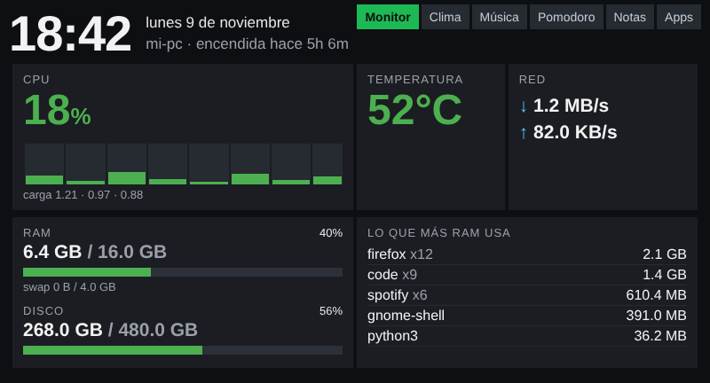
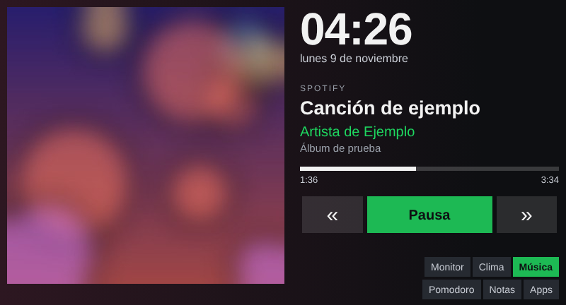
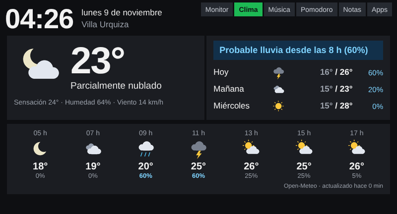
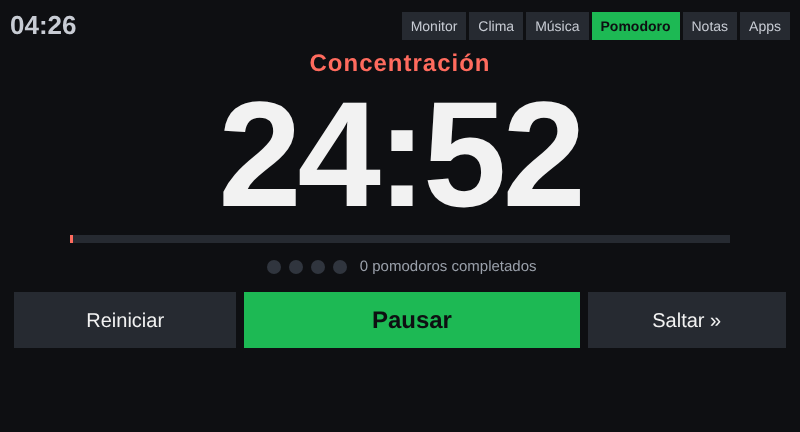
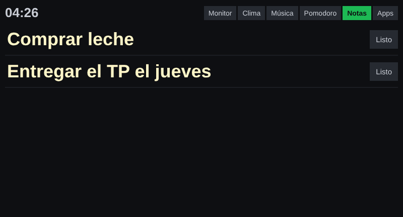
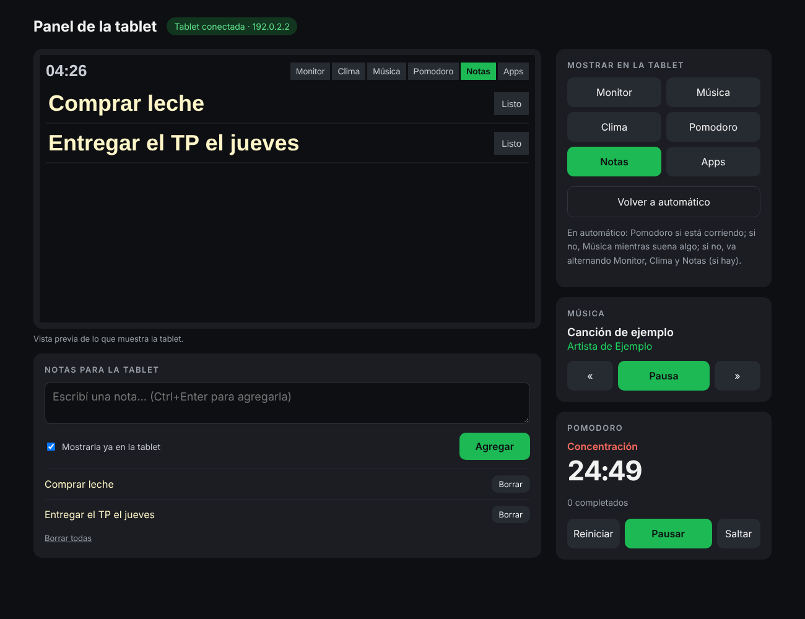
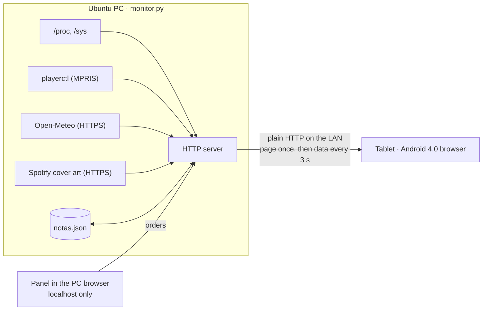

# tablet-coby · a second life for a 2012 tablet

*[Leer en español](README.es.md)*


A self-hosted desk dashboard for an old **Coby Kyros MID7033** (Android 4.0, 512 MB RAM, 800×480 resistive screen with a broken touch panel). A single Python file running on my Ubuntu PC serves pages that the tablet shows full-screen: PC stats, what's playing on Spotify, the weather in my neighbourhood, a pomodoro timer and notes I type from the PC.

No app is installed on the tablet and nothing needs root: it is just the stock 2012 browser pointed at my PC.

| Monitor | Music | Weather |
|---|---|---|
|  |  |  |
| **Pomodoro** | **Notes** | **Control panel (on the PC)** |
|  |  |  |

<sub>Screenshots use demo data. The UI is in Spanish.</sub>

## Features

- **PC monitor**: CPU (total and per core), RAM, disk, temperature, network speed and the apps using the most memory, read straight from `/proc` and `/sys`.
- **Now playing**: Spotify (or any MPRIS player) with cover art, progress and play/pause/next/previous buttons that control the PC. The background takes the cover's colour.
- **Weather**: current conditions, a "will it rain in the next 12 h?" banner, a 3-day outlook and hourly forecast ([Open-Meteo](https://open-meteo.com/), free and no API key).
- **Pomodoro**: 25/5 with a long break every 4, desktop notifications when a phase ends.
- **Notes**: typed on the PC, shown huge on the tablet; dismissed with one click. Saved to disk.
- **Smart rotation**: pomodoro while it runs, music while something is playing, otherwise it cycles monitor, weather and notes. A page chosen by hand is respected for 5 minutes.
- **Control panel** at `http://localhost:8080/control`: live preview of the tablet, switch its page, control music and the pomodoro, write notes. Only reachable from the PC itself.
- **App sideloading**: drop an `.apk` in `apk/` and install it from the tablet with one click.

## How it works



The tablet loads each page once. A small script then asks for `?parcial=1` every 3 seconds and receives only the page's sections, joined by an ASCII record separator. It replaces only the sections that changed, so the screen never flickers and the album cover is not redrawn unless the song changes. The last field of each response is the page the tablet should be showing: either the rotation's suggestion or a one-shot order from the panel.

## Working within a 2012 browser

Most of the interesting problems came from the hardware, not the features:

| Constraint | What I did |
|---|---|
| The browser can't do modern TLS, so almost every HTTPS site fails | Everything is served over plain HTTP on the LAN. The PC fetches HTTPS resources (cover art, forecast) and passes them on. |
| JavaScript is ES5: no `fetch`, `let`, arrow functions or template literals | The tablet script is written in ES5 with `XMLHttpRequest`. Layout uses tables instead of flexbox or grid. |
| No emoji fonts | Weather icons are drawn on the PC with Pillow as transparent PNGs, then cached. |
| The device reports itself as low density, so the browser scaled everything to 75 % | `target-densitydpi=device-dpi` in the viewport, so 1 CSS px is 1 physical px. |
| Every change to the code needed someone to reload the tablet by hand | Each page carries a version hash of `monitor.py`. If an outdated page polls, the server tells it to reload. |
| The touch panel is broken, so input is a USB mouse over OTG and typing is painful | Nothing on the tablet requires typing. Text input (notes) and remote control live in the PC panel. |
| Weak CPU, 512 MB of RAM | Cover art is resized on the PC to the exact pixel size shown. The cover-tinted background is computed once per song. |

Other details:

- **Panel is local-only.** Requests from any address other than the PC itself get `403`, so nobody else on the Wi-Fi can drive the tablet or edit notes.
- **One-shot orders.** A panel order is consumed by the first tablet poll and expires after 60 s, so a stale order never yanks the screen later.
- **Path traversal safe.** `apk/` downloads go through `basename()`, and the icon endpoint only accepts a whitelist of names.
- **Atomic writes.** Notes are written to a temp file and moved into place with `os.replace`, so a crash can't leave half a file.
- **No required dependencies.** Standard library only. Pillow is optional (icons, cover resizing and tint). `playerctl` is needed only for the music page.

## Setup

Requirements: Linux, Python 3.10+. Optional: `playerctl` (music), `python3-pil` (icons and covers), `notify-send` (pomodoro notifications).

```bash
sudo apt install playerctl python3-pil
git clone https://github.com/FelipePoliszuk/tablet-coby.git ~/tablet-coby
python3 ~/tablet-coby/monitor.py
```

It prints the address to open on the tablet, for example `http://192.168.1.50:8080`. On the tablet, enable full screen in the browser (*Settings → Labs*) and *Stay awake* in the developer options.

### Configuration

Defaults live at the top of `monitor.py`. To change them without touching the code, copy the example and edit only what you need:

```bash
cp config.example.json config.json
```

```json
{ "ZONA_NOMBRE": "Palermo", "ZONA_LAT": -34.58, "ZONA_LON": -58.42, "POMO_TRABAJO": 3000 }
```

Options: port and refresh rate, rotation timing (`ROTAR_SIN_MUSICA`, `ROTACION_SEG`, `ESPERA_SIN_MUSICA`, `BLOQUEO_MANUAL`), weather location and time zone, and pomodoro lengths. `config.json` is git-ignored, so personal data such as your location stays out of the repo. Unknown keys and invalid JSON are reported and ignored.

### Run it on login (systemd)

```bash
mkdir -p ~/.config/systemd/user
cp ~/tablet-coby/monitor.service ~/.config/systemd/user/
systemctl --user enable --now monitor.service
journalctl --user -u monitor.service -f   # logs
```

If you use a firewall, allow only the tablet: `sudo ufw allow from <tablet-ip> to any port 8080 proto tcp`.

## Tests

```bash
python3 -m unittest discover -s tests -v
```

The suite covers formatting, pomodoro phases, notes persistence and HTML escaping, the rotation priorities, the panel order queue and `config.json` loading. It also runs the real HTTP server on a free port to check every page, the path traversal protection and that the panel rejects requests from other addresses. GitHub Actions runs it on Python 3.10 and 3.12.

## Project layout

```
monitor.py                 server, pages and tablet script (single file on purpose)
config.example.json        every setting with its default value
tests/test_monitor.py      unit and HTTP tests (unittest, no dependencies)
monitor.service            systemd user unit
docs/                      screenshots
config.json                (ignored) your own settings
apk/                       (ignored) APKs to sideload to the tablet
notas.json                 (ignored) saved notes
```

## License

MIT, see [LICENSE](LICENSE).
